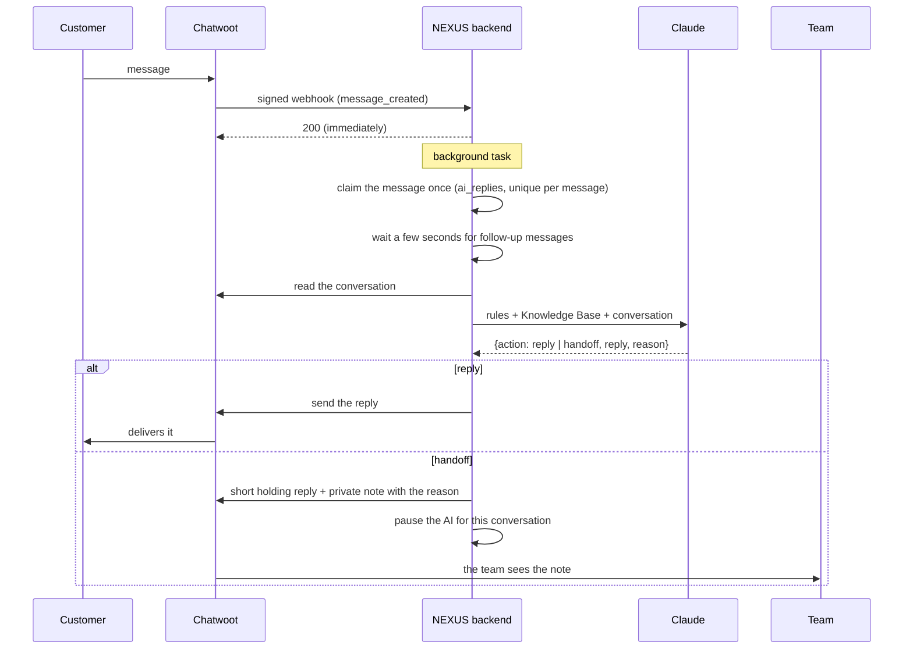

# AI agent and Knowledge Base

NEXUS answers customer messages on every connected channel (Facebook, Instagram,
WhatsApp, website chat) with Claude, using only what is written in the Knowledge Base.

## How a message is handled

| Rule | Why |
|---|---|
| Answers only from the Knowledge Base | No invented prices, links or promises |
| Hands over on payments, refunds, complaints, legal or personal-data topics, or when unsure | Humans handle what is sensitive |
| Steps back as soon as a team member replies (in NEXUS or in Chatwoot) | It never talks over a person |
| One answer per customer message, enforced by a database constraint | Repeated webhooks cannot cause double replies |
| Waits a few seconds and answers the newest message | Several quick messages get one reply |
| At most 12 replies per conversation per hour, then pauses | A safety brake against loops |
| Replies in the customer's language | Arabic and English both work |

## Setting it up

1. Get an API key at platform.claude.com and add it to the backend:
   - locally: `ANTHROPIC_API_KEY=...` in `.env`, then `docker compose up -d backend`
   - on Railway: backend → Variables → `ANTHROPIC_API_KEY`, then **Deploy**
2. In NEXUS, open **Knowledge Base** and add articles: prices, services, hours,
   booking, policies. One topic per article.
3. Open **AI Employees**, fill in the business name and instructions, and switch
   the agent on.

## Settings (environment variables)

| Variable | Default | Meaning |
|---|---|---|
| `ANTHROPIC_API_KEY` | empty | Without it the agent stays off |
| `AI_MODEL` | `claude-opus-5-5` | Claude model |
| `AI_EFFORT` | `low` | How much the model thinks before answering: `low`, `medium`, `high` |
| `AI_DEBOUNCE_SECONDS` | `4` | Wait before answering, to catch follow-up messages |
| `AI_MAX_REPLIES_PER_HOUR` | `12` | Per conversation |
| `KB_FULL_CONTEXT_CHARS` | `120000` | Up to this size the whole Knowledge Base is sent; above it, the best-matching articles |

## Knowledge retrieval

Small knowledge bases are sent whole with every request. Prompt caching makes the
repeated part cheap, and nothing can be missed. Beyond `KB_FULL_CONTEXT_CHARS`, NEXUS
searches the articles with PostgreSQL full-text search (the `simple` configuration,
which works for Arabic and English) and sends the 8 best matches.

## Cost

Claude Opus 5.5 costs $4 per million input tokens and $20 per million output tokens.
A typical reply with a small Knowledge Base uses a few thousand input tokens and a few
hundred output tokens, so roughly one to three US cents. The exact numbers for every
reply are shown on the AI Employees page.

## Where the code is

| File | What it does |
|---|---|
| `backend/app/services/ai_agent.py` | Prompt, Claude call, reply / handoff logic |
| `backend/app/services/knowledge.py` | Knowledge storage and retrieval |
| `backend/app/services/events.py` | Starts the agent on customer messages, pauses it on team replies |
| `backend/tests/test_ai.py` | 23 tests with a fake Claude, no network |
| `frontend/src/components/knowledge/` | Knowledge Base page |
| `frontend/src/components/ai/` | AI Employees page |
