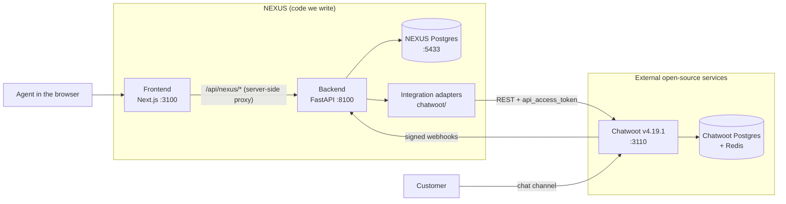
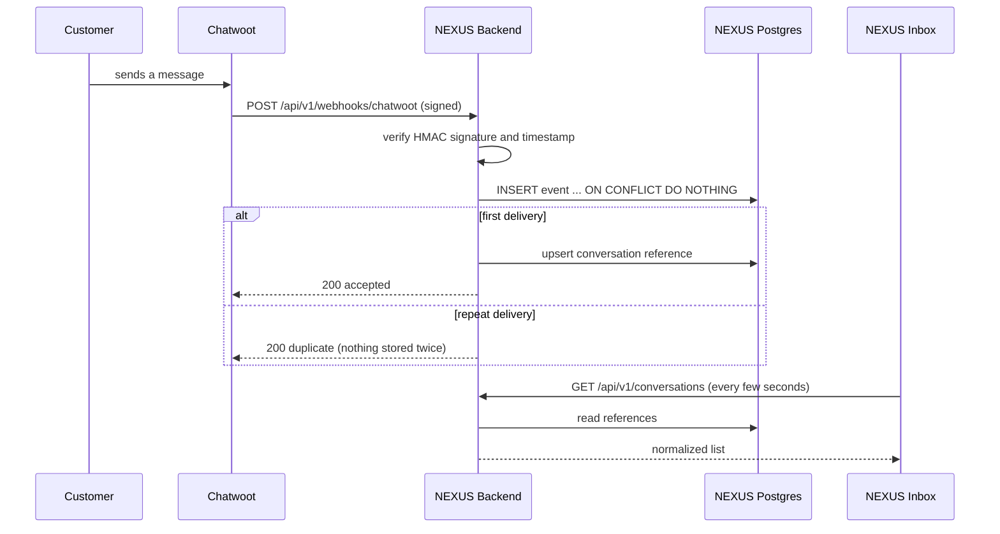
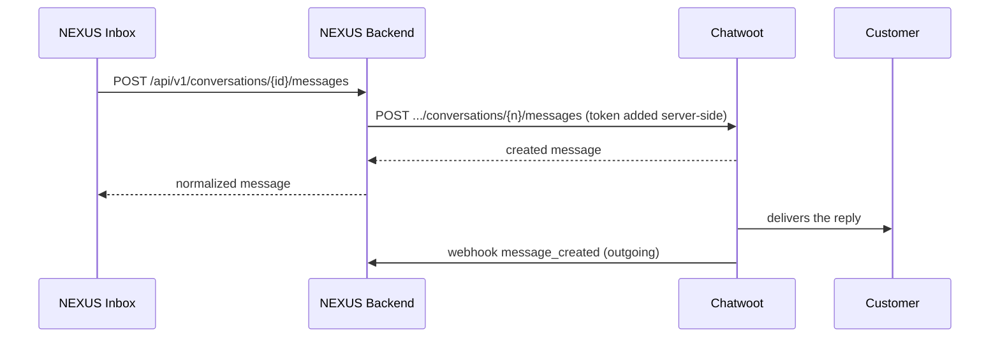

# NEXUS AI architecture (Lesson 01)

NEXUS AI is one custom interface in front of several open-source systems. Lesson 01
builds the foundation and connects the first of them, Chatwoot.

## The five layers

| Layer | Folder | Knows about | Must not know about |
|---|---|---|---|
| Frontend | `frontend/` | NEXUS shapes (`Conversation`, `Message`) | Chatwoot, tokens, the database |
| Backend | `backend/app/api`, `services` | NEXUS shapes, the adapter interface | Chatwoot JSON field names |
| Integration adapters | `backend/app/integrations/chatwoot` | Chatwoot URLs, headers, payloads | Pages, UI state |
| Database | `nexus-db` container | NEXUS tables only | Chatwoot's tables |
| External services | Official images | Their own data | NEXUS |

**The rule that keeps this maintainable:** Chatwoot's field names stop at
`integrations/chatwoot/mapper.py`. Everything above that file sees one normalized
shape. When Lesson 03 adds Twenty CRM, it gets its own adapter folder and the
frontend does not change.

## Why two databases

Chatwoot owns its database. Reading it directly would couple NEXUS to private
tables that change between Chatwoot releases, and would bypass Chatwoot's
permission checks. NEXUS therefore uses only two public doors:

1. **REST API** (NEXUS asks Chatwoot): list conversations, read messages, send a reply.
2. **Webhooks** (Chatwoot tells NEXUS): a message arrived, a status changed.

The NEXUS database stores what NEXUS itself needs to remember:

| Table | Purpose |
|---|---|
| `webhook_events` | Every event received, normalized, with a unique delivery key so a repeat is ignored |
| `conversations` | A lightweight reference to each external conversation, so the Inbox list loads without calling Chatwoot |

Message bodies are not copied in Lesson 01. They are fetched from Chatwoot through
the adapter when a conversation is opened, so Chatwoot stays the source of truth.

## The two flows

### Inbound: customer message reaches the NEXUS Inbox

### Outbound: agent reply reaches the customer

## Security decisions

| Decision | Reason |
|---|---|
| The Chatwoot token lives only in the backend's environment | A token in browser code can be read by anyone who opens DevTools |
| The browser calls `/api/nexus/*` on the frontend's own origin | No CORS setup, and the backend address is never exposed |
| Webhooks are verified with HMAC-SHA256 over `timestamp.raw_body` | Proves the request came from our Chatwoot and was not altered |
| Old timestamps are rejected (default 300 s) | A captured request cannot be replayed later |
| Published ports bind to `127.0.0.1` | Nothing is reachable from other machines on the network |
| Webhooks are refused entirely until a secret is configured | Without a secret we cannot tell Chatwoot from a stranger, so we fail closed |
| Chatwoot runs with `SAFE_FETCH_ALLOW_PRIVATE_NETWORK=true` | Chatwoot blocks private webhook targets by default; local Docker needs it. Remove it in production, where the backend has a public HTTPS address |
| Chatwoot logs at `warn` | At `info` its worker prints the webhook secret in job arguments |
| `.env` is git-ignored, `.env.example` has no values | Secrets never enter the repository |

## Failure behaviour

| Situation | What the backend does | What the user sees |
|---|---|---|
| Chatwoot credentials missing | `503 integration_not_configured` | A setup notice in the Inbox, not a crash |
| Chatwoot unreachable or returns 5xx | `502 upstream_unavailable` | "Chatwoot is not responding", cached list still shown |
| Chatwoot rejects the token | `502 upstream_auth_failed` | Clear message to check the token |
| Webhook with a bad or missing signature | `401`, nothing stored | Nothing |
| Same webhook delivered twice | `200 duplicate`, one row, counter incremented | Nothing |

## Docker services

| Service | Image | Host port | Role |
|---|---|---|---|
| `frontend` | built from `frontend/` | 3100 | NEXUS interface |
| `backend` | built from `backend/` | 8100 | NEXUS API and integration layer |
| `nexus-db` | `postgres:17-alpine` | 5433 | NEXUS data |
| `chatwoot-rails` | `chatwoot/chatwoot:v4.19.1` | 3110 | Chatwoot web and API |
| `chatwoot-sidekiq` | `chatwoot/chatwoot:v4.19.1` | none | Chatwoot background jobs, sends webhooks |
| `chatwoot-init` | `chatwoot/chatwoot:v4.19.1` | none | Runs `db:chatwoot_prepare` once, then exits |
| `chatwoot-postgres` | `pgvector/pgvector:pg16` | none | Chatwoot data |
| `chatwoot-redis` | `redis:alpine` | none | Chatwoot queues and cache |

The Chatwoot services mirror Chatwoot's official `docker-compose.production.yaml`.
The port numbers avoid the common defaults (3000, 8000, 5432) so the stack starts
on machines that already run other projects.

## Out of scope for Lesson 01

Authentication, real-time push (the Inbox polls), AI agents, Twenty CRM, Plane,
Activepieces and approvals. Their pages exist in the navigation and are marked
as upcoming.
