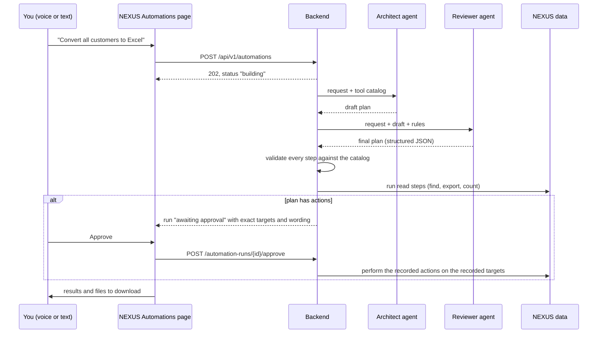

# Automation builder (voice + CrewAI)

Say or type what you need, for example "convert all customers to an Excel sheet".
A CrewAI crew turns it into an automation built from NEXUS tools, NEXUS runs it,
and you download the result. Anything that messages customers or changes data
waits for your approval.

## Safety design

| Rule | Why |
|---|---|
| The crew only chooses tools from a fixed catalog; it never writes or runs code | Nothing unexpected can run on the server |
| Every plan is validated (tool names, parameters, step references) before it runs | A wrong plan fails safely with a reason |
| The agents never see customer data | Data stays in NEXUS; the AI only plans |
| Read tools run immediately; action tools wait for approval | Customers are never contacted by surprise |
| An approval shows the exact wording and every recipient, and acts on exactly those | What you approve is what happens |
| A run can be approved only once | Double clicks cannot send twice |
| At most 300 recipients per message action | A brake on mistakes |
| Saved plans re-run without the AI | Repeats are instant and free |

## Tools

| Tool | Kind | What it does |
|---|---|---|
| `find_customers` | read | Customers, filtered by text, channel, phone/email present, activity |
| `find_conversations` | read | Conversations, filtered by status, channel, awaiting reply, activity |
| `export_excel` | read | An .xlsx file from a find step, with chosen columns |
| `summarize` | read | Counts, optionally grouped by channel, status or country |
| `send_message` | action | The same message to each customer or conversation |
| `add_note` | action | A private note on each conversation |
| `set_conversation_status` | action | Open or resolve conversations |
| `set_ai` | action | Turn the AI agent on or off per conversation |

To add an ability, add a tool in `backend/app/automations/tools.py`. The crew sees
the catalog automatically, and the executor runs it.

## Voice

The page uses the browser's own speech recognition (Web Speech API): no key and
no cost, Arabic (`ar-JO`) or English. It works in Chrome and Edge; other browsers
can type instead. The text can be edited before sending.

## CrewAI and Claude

CrewAI's Anthropic extra pins an older Anthropic SDK, which would break the AI
agent. NEXUS therefore installs CrewAI without it and gives the agents
`ClaudeForCrew` (`backend/app/automations/crew.py`), a small CrewAI LLM class
that calls Claude through the same official SDK (2.8.0) with structured output.
CrewAI telemetry is turned off.

Building one automation makes two Claude calls (architect, reviewer), typically a
few thousand tokens: about 3 to 8 US cents with Claude Opus 5.5. Re-runs cost nothing.

## Where the code is

| File | What it does |
|---|---|
| `backend/app/automations/tools.py` | The tool catalog |
| `backend/app/automations/crew.py` | The crew and the CrewAI → Claude bridge |
| `backend/app/automations/executor.py` | Validation, read phase, approval phase |
| `backend/app/automations/excel.py` | Excel files |
| `backend/app/api/automations.py` | API, approvals, downloads |
| `backend/tests/test_automations.py` | 26 tests, crew replaced by fixed plans |
| `frontend/src/components/automations/` | Voice composer, automations, approvals |
