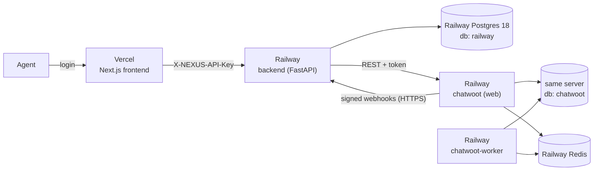

# Deploying NEXUS (Vercel + Railway)

Local development uses Docker Compose for everything. Online, the pieces are split
between two platforms, because Vercel runs only the Next.js frontend:



| Service | Platform | Built from |
|---|---|---|
| Frontend | Vercel | GitHub repo, root directory `frontend` |
| backend | Railway | GitHub repo, root directory `/backend` (its Dockerfile) |
| chatwoot | Railway | Image `chatwoot/chatwoot:v4.19.1`, start `bundle exec rails s -p 3000 -b 0.0.0.0`, pre-deploy `bundle exec rails db:chatwoot_prepare` |
| chatwoot-worker | Railway | Same image, start `bundle exec sidekiq -C config/sidekiq.yml` |
| Postgres | Railway database | Shared: NEXUS uses database `railway`, Chatwoot creates `chatwoot`. Railway's Postgres includes `pgvector`, which Chatwoot needs |
| Redis | Railway database | Used by Chatwoot only |

Pushing to `main` redeploys the frontend and the backend automatically.

## Protection

Lesson 01 has no user accounts, so a deployed NEXUS is protected in two layers.
Both are off when their variables are empty, which keeps local development unchanged.

| Layer | Where | Variables |
|---|---|---|
| Shared login (HTTP Basic) on every page and API route | `frontend/src/proxy.ts` | `NEXUS_BASIC_AUTH_USER`, `NEXUS_BASIC_AUTH_PASSWORD` on Vercel |
| Backend accepts `/api/v1` calls only from the frontend server | `backend/app/api/deps.py` | `NEXUS_API_KEY` on Railway and on Vercel (same value) |

Webhooks are not covered by the key: they prove themselves with Chatwoot's HMAC
signature, as in the lesson.

## Variables

**Vercel (frontend):** `NEXUS_API_URL` (the backend's public HTTPS address),
`NEXUS_API_KEY`, `NEXUS_BASIC_AUTH_USER`, `NEXUS_BASIC_AUTH_PASSWORD`.

**Railway backend:**

| Variable | Value |
|---|---|
| `DATABASE_URL` | `${{Postgres.DATABASE_URL}}` (the backend adds the `psycopg` driver itself) |
| `NEXUS_API_KEY` | a long random string |
| `CHATWOOT_BASE_URL`, `CHATWOOT_PUBLIC_URL` | `https://${{chatwoot.RAILWAY_PUBLIC_DOMAIN}}` |
| `CHATWOOT_ACCOUNT_ID` | `1` |
| `CHATWOOT_API_TOKEN` | from Chatwoot, Profile Settings |
| `NEXUS_WEBHOOK_URL` | `https://${{RAILWAY_PUBLIC_DOMAIN}}/api/v1/webhooks/chatwoot` |
| `CHATWOOT_WEBHOOK_SECRET`, `CHATWOOT_INBOX_IDENTIFIER` | printed by `chatwoot-setup` |

**Railway chatwoot and chatwoot-worker:** the same Chatwoot variables as in
`docker-compose.yml`, with `POSTGRES_HOST/PORT/USERNAME/PASSWORD` taken from
`${{Postgres.PG...}}`, `POSTGRES_DATABASE=chatwoot`, `REDIS_URL=${{Redis.REDIS_URL}}`
and `FRONTEND_URL=https://${{chatwoot.RAILWAY_PUBLIC_DOMAIN}}`. The worker uses
`SECRET_KEY_BASE=${{chatwoot.SECRET_KEY_BASE}}` so both share one key.

Online, Chatwoot sends webhooks to the backend's public HTTPS address, so
`SAFE_FETCH_ALLOW_PRIVATE_NETWORK` is not needed.

## Order of setup

1. Create the Railway project with Postgres and Redis.
2. Add `chatwoot` and `chatwoot-worker`, give `chatwoot` a public domain, deploy.
3. **Immediately** open Chatwoot and create the admin account. Until you do,
   anyone who finds the address can.
4. Add the `backend` service, set its variables, give it a public domain, deploy.
5. Put the Chatwoot access token in `CHATWOOT_API_TOKEN` and deploy.
6. Run the setup command inside the backend and store what it prints:

   ```bash
   railway ssh -s backend "cd /app && python -m app.cli chatwoot-setup"
   ```

7. On Vercel set the four variables, redeploy, add your domain.

## Gotchas met while deploying

- **Variables edited in the Railway dashboard are staged.** They take effect only
  after you press Deploy.
- **`railway redeploy` repeats the previous deployment's settings.** After changing
  a start command, trigger a new deployment instead.
- **Chatwoot keeps settings in its database.** Its first start stores empty
  `FB_APP_ID`/`FB_APP_SECRET` rows, and those win over environment variables.
  Set Meta values in Chatwoot's Super Admin › App Configs.
- **Some networks block `*.vercel.app`.** Use your own domain, or test from
  another network, before deciding a deployment is broken.

## Limits

- Chatwoot's uploaded files are stored inside the container, so attachments are
  lost when it redeploys. Add a volume or S3 storage before using attachments.
- Cost on Railway is usage-based. This setup uses about 1.2 GB of memory in total.
