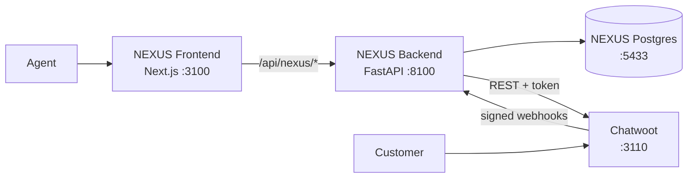

# Lesson 01: Foundation and Chatwoot integration

**Duration:** 90 minutes · **Result:** a customer message travels from Chatwoot
into our own NEXUS Inbox, and a reply written in NEXUS reaches the customer.

```
Customer message → Chatwoot → NEXUS Backend → NEXUS Inbox → Agent reply → Chatwoot
```

By the end you will have eight containers running, a custom interface on
`http://localhost:3100`, and a backend that verifies, stores and deduplicates
Chatwoot webhooks.

---

## 1. What we are building and why

NEXUS AI is one interface in front of several open-source systems. Users never
open Chatwoot, Twenty or Plane directly. Lesson 01 builds the frame and connects
the first system.



Full detail: [architecture.md](../architecture.md) and
[api-contracts.md](../api-contracts.md).

### The five components

| Component | Problem it solves | Why this technology | How it talks to the others | How to verify |
|---|---|---|---|---|
| **Frontend** | Users need one interface, not four | Next.js gives pages and a server side; shadcn/ui gives components we own as source | Calls `/api/nexus/*` on its own origin | Open `http://localhost:3100` |
| **Proxy route** | The browser must not hold secrets or know internal addresses | A Next.js route reads its target at request time, so one image works everywhere | Forwards to FastAPI, passes only JSON | `curl localhost:3100/api/nexus/health` |
| **Backend** | Something must hold tokens, remember events and translate | FastAPI validates from type hints and generates `/docs` | SQL to Postgres, HTTP to Chatwoot | `curl localhost:8100/health/ready` |
| **Adapter** | Chatwoot's JSON must not spread through our code | A small interface with one implementation per system | The backend calls the interface, never Chatwoot directly | `pytest tests/test_mapper.py` |
| **NEXUS database** | We need our own memory of events and conversations | Postgres has unique constraints, which make deduplication reliable | Only the backend connects to it | `\dt` shows two tables |
| **Chatwoot** | Channels, contacts and delivery already exist there | Official image, unmodified, so upgrades stay easy | REST in, webhooks out | Open `http://localhost:3110` |

### Three ideas to remember

1. **Normalize at the edge.** Chatwoot calls an incoming message `0` in its API
   and `"incoming"` in its webhooks. `mapper.py` turns both into `inbound`.
   Nothing above that file knows the difference.
2. **Verify, then trust.** A webhook endpoint is a public door. We check the
   HMAC signature against the raw bytes before parsing anything.
3. **Expect repeats.** Webhook senders retry. A unique constraint in the
   database, not an `if` in our code, guarantees each delivery is stored once.

---

## 2. Lesson plan

| Minutes | Segment | What students see |
|---|---|---|
| 0–10 | Vision and architecture | The diagram above; why an adapter layer |
| 10–20 | `docker-compose.yml` walkthrough, start the stack | Eight services, health checks turning green |
| 20–40 | Frontend: shell, navigation, Inbox layout | `http://localhost:3100`, upcoming pages |
| 40–55 | Backend: settings, models, migration, `/health` | `/docs`, `pytest` |
| 55–75 | Chatwoot: onboarding, token, webhook, signature, dedupe | "Chatwoot connected" in the sidebar |
| 75–85 | Live end-to-end demo, including a duplicate delivery | Sections 5.1 to 5.3 |
| 85–90 | Recap, troubleshooting, what comes next | |

---

## 3. Prerequisites

| Need | Version used when this lesson was built | Check |
|---|---|---|
| Docker Desktop | Engine 29.4, Compose v5.1 | `docker compose version` |
| Node.js | 24.22 (20.9 or newer works) | `node --version` |
| Git | 2.53 | `git --version` |
| Free memory | About 1.2 GB for these containers | |
| Free disk | About 4 GB for images | |

**Ports.** The stack uses 3100, 8100, 3110 and 5433 on `127.0.0.1`. They were
chosen to avoid the usual 3000, 8000 and 5432. If one is taken, change it in
`.env`.

```powershell
# Windows: is anything listening on our ports?
Get-NetTCPConnection -State Listen | Where-Object LocalPort -in 3100,8100,3110,5433
```

```bash
# macOS / Linux
lsof -i :3100 -i :8100 -i :3110 -i :5433
```

---

## 4. Setup

Each step ends with a check. Do not continue until the check passes.

### Step 1: get the code and create `.env`

```bash
git clone <repository url> nexus-ai
cd nexus-ai
node scripts/init-env.mjs
```

Expected:

```
Created .env from .env.example
Generated: NEXUS_DB_PASSWORD, CHATWOOT_SECRET_KEY_BASE, CHATWOOT_POSTGRES_PASSWORD, CHATWOOT_REDIS_PASSWORD
```

`.env` holds secrets and is listed in `.gitignore`. Check: `git check-ignore .env`
prints `.env`.

### Step 2: start everything

```bash
docker compose up -d --build
```

The first run downloads about 3 GB and takes several minutes. Chatwoot prepares
its database once (`chatwoot-init`), then its web server starts.

Check:

```bash
docker compose ps -a
```

Seven services are `running` and `chatwoot-init` is `exited (0)`. That exit is
correct: it is a one-time setup job.

### Step 3: health checks

```bash
curl http://localhost:8100/health
curl http://localhost:3100/api/health
curl http://localhost:3110/api
curl http://localhost:8100/health/ready
```

Expected:

```json
{"status":"ok","service":"nexus-backend"}
{"status":"ok","service":"nexus-frontend"}
{"version":"4.19.1","timestamp":"...","queue_services":"ok","data_services":"ok"}
{"status":"ready","checks":{"database":{"ok":true},"chatwoot":{"ok":false,"configured":false,"detail":"Add CHATWOOT_API_TOKEN and CHATWOOT_ACCOUNT_ID to .env."}}}
```

Chatwoot reads `"configured": false`. That is the right answer for now. Open
`http://localhost:3100`: NEXUS loads and the sidebar says **Chatwoot not
configured**.

### Step 4: create your Chatwoot admin

Open `http://localhost:3110`. A fresh Chatwoot shows an onboarding form.

1. Enter a name, a company name, an email and a password.
2. Untick the newsletter box if you do not want your email sent to Chatwoot.
3. Submit, then sign in.

This account lives only in your local Chatwoot database.

### Step 5: give NEXUS the API token

1. In Chatwoot, open **Profile Settings** (from your avatar in the sidebar).
2. Find **Access Token** on that page and copy it.
3. Open `.env` and set:

```
CHATWOOT_ACCOUNT_ID=1
CHATWOOT_API_TOKEN=<the token you copied>
```

The account id is the number in the Chatwoot URL: `/app/accounts/1/...`.

4. Reload the backend so it reads the new values:

```bash
docker compose up -d backend
```

Check:

```bash
curl http://localhost:8100/health/ready
```

```json
"chatwoot":{"ok":true,"configured":true,"detail":"Connected to account 1"}
```

### Step 6: create the demo inbox and the webhook

```bash
docker compose exec backend python -m app.cli chatwoot-setup
```

Expected:

```
Signed in to Chatwoot as <your name> (account 1)
Created inbox 'NEXUS Demo Channel' (id 1)
Registered webhook to http://backend:8000/api/v1/webhooks/chatwoot (id 1)

Put these two lines in your .env file:

CHATWOOT_INBOX_IDENTIFIER=...
CHATWOOT_WEBHOOK_SECRET=...
```

Copy the two lines into `.env`, then reload again:

```bash
docker compose up -d backend
```

The command uses only Chatwoot's public API. Running it twice is safe: it
reports `already exists` and creates nothing new.

> **Why `http://backend:8000` and not `localhost`?** Chatwoot sends the webhook
> from inside its own container. Inside the Docker network, our backend is
> called `backend`. `localhost` there would mean the Chatwoot container itself.

### Step 7: open NEXUS

`http://localhost:3100` → the sidebar now says **Chatwoot connected**.

---

## 5. Demonstrations

The outputs below are real, captured when this lesson was built.

### 5.1 A customer message arrives

We play the customer through Chatwoot's public Client API, which is what a
customer's app or website would call. It uses no agent token.

```bash
docker compose exec backend python -m app.cli simulate-customer \
  --name "Omar Khalil" \
  --message "Hi, I run a restaurant in Amman. Can you manage our Instagram ads?"
```

```
Created contact 'Omar Khalil'
Started Chatwoot conversation #2
Customer sent message #4: Hi, I run a restaurant in Amman. Can you manage our Instagram ads?

To continue this conversation as the same customer, add:
  --source-id ded8eb9b-... --conversation 2
```

Keep the last line. You need it in 5.2.

Now follow the message through each transition:

| Transition | How to observe it | What you see |
|---|---|---|
| Customer → Chatwoot | Chatwoot's Conversations screen | Omar Khalil's conversation |
| Chatwoot → Backend | `docker compose logs backend --since 1m` | `POST /api/v1/webhooks/chatwoot HTTP/1.1" 200 OK` |
| Backend → Database | NEXUS Dashboard → Event stream | `message_created  Omar Khalil: Hi, I run a restaurant...` |
| Backend → Inbox | NEXUS → Unified Inbox | The conversation, with an amber dot: awaiting reply |

The Inbox refreshes by itself every four seconds. No page reload is needed.

### 5.2 A reply leaves NEXUS

In the Inbox, open Omar's conversation, type a reply and press Enter.

Then check from the **customer's** side. This asks Chatwoot, not NEXUS, so it
proves the reply really arrived:

```bash
docker compose exec backend python -m app.cli customer-view \
  --source-id <source id from 5.1> --conversation 2
```

```
Chatwoot conversation #2, customer's view:

  CUSTOMER [16:21:08] Hi, I run a restaurant in Amman. Can you manage our Instagram ads?
  AGENT    [16:21:36] Hello Omar, yes we manage Instagram ads for restaurants. Can I call you tomorrow at 11?
```

Open the same conversation in Chatwoot (`http://localhost:3110`): the reply is
there too, sent by your admin user.

**Where was the token?** Open the browser's DevTools → Network and inspect the
`messages` request. It contains only `{"content": "..."}`. The backend added
the `api_access_token` header.

### 5.3 The same webhook delivered twice

```bash
docker compose exec backend python -m app.cli replay-webhook
```

```
Replayed 'conversation_updated' with delivery id f703b183-ad92-45f8-9e5b-6b04ab63282f
Response: 200 {"status":"duplicate","event_id":"31c5f00f-..."}
Rows in webhook_events: 7 before, 7 after
Duplicate count on that event: 1
```

Run it again: still 7 rows, duplicate count 2. The Dashboard's **Duplicates
ignored** number rises and the event shows a "2 duplicates ignored" label.

Things to point out:

- The copy carried a **valid** signature. Authentication did not stop it. The
  unique constraint did.
- We answer `200`, not an error. An error would tell the sender to retry again.
- Chatwoot puts the delivery id in the `X-Chatwoot-Delivery` header. It is part
  of the job Chatwoot queues, so a re-run of that job carries the same id.

### 5.4 A forged webhook

```bash
curl -i -X POST http://localhost:8100/api/v1/webhooks/chatwoot \
  -H "Content-Type: application/json" \
  -d '{"event":"message_created","content":"forged"}'
```

```
HTTP/1.1 401 Unauthorized
{"error":{"code":"invalid_signature","message":"The webhook is missing its signature headers."}}
```

With a made-up signature the message becomes `The webhook signature does not
match.` In both cases nothing is stored.

### 5.5 Chatwoot goes down

```bash
docker compose stop chatwoot-rails
```

Within about twenty seconds:

- The sidebar turns red: **Chatwoot not responding**.
- The conversation list still shows, because it comes from the NEXUS database.
- An open thread shows *Chatwoot is not responding. Check that its containers
  are running.* with a **Try again** link. Messages already on screen stay there.
- The API answers `502` with `"code":"upstream_unavailable"`.

```bash
docker compose start chatwoot-rails
```

NEXUS recovers by itself on the next refresh.

### 5.6 Missing credentials

In `.env`, put a `#` in front of the `CHATWOOT_API_TOKEN` line, then reload:

```bash
docker compose up -d backend
```

NEXUS still starts. The Inbox shows a setup notice with the three steps, the
reply box is disabled, and the API answers `503 integration_not_configured`.
Remove the `#` and run the same command to restore it.

### 5.7 Run the tests

```bash
docker compose exec backend pytest
```

```
50 passed, 1 warning in 6.19s
```

The tests use a real PostgreSQL database named `nexus_test` and a fake Chatwoot,
so they need no network. Worth reading together:
`test_many_simultaneous_copies_still_produce_one_row` sends the same delivery
from eight threads at once and asserts exactly one row.

---

## 6. Code tour

Read the files in this order. Each one is short.

| # | File | What to notice |
|---|---|---|
| 1 | `docker-compose.yml` | Two groups of services; which ports are published and which are not |
| 2 | `backend/app/core/config.py` | Every secret arrives through the environment |
| 3 | `backend/app/models/webhook_event.py` | The `UniqueConstraint` that makes deduplication work |
| 4 | `backend/app/integrations/base.py` | The six methods every messaging system must offer |
| 5 | `backend/app/integrations/chatwoot/signature.py` | HMAC over the raw bytes, constant-time compare, timestamp window |
| 6 | `backend/app/integrations/chatwoot/mapper.py` | The only file with Chatwoot field names |
| 7 | `backend/app/services/events.py` | `INSERT ... ON CONFLICT DO NOTHING`, then act |
| 8 | `backend/app/api/webhooks.py` | Order matters: authenticate, parse, store |
| 9 | `frontend/src/app/api/nexus/[...path]/route.ts` | The browser's only door to the backend |
| 10 | `frontend/src/lib/types.ts` | NEXUS shapes, with no Chatwoot names |
| 11 | `frontend/src/components/inbox/inbox-view.tsx` | Polling, the selected conversation in the URL, optimistic reply |

---

## 7. Acceptance criteria and results

Recorded on 2026-11-10, Windows 11, Docker Desktop (Engine 29.4.1).

| Criterion | Result | Evidence |
|---|---|---|
| Docker services start | Pass | 7 running, `chatwoot-init` exited 0 |
| Frontend health check | Pass | `GET :3100/api/health` → `{"status":"ok"}` |
| Backend health check | Pass | `GET :8100/health` → ok; `/health/ready` → database ok, Chatwoot connected |
| NEXUS interface loads | Pass | Dashboard, Inbox and six upcoming pages render; no console errors |
| A real Chatwoot conversation appears in NEXUS | Pass | Conversation #2 created through Chatwoot's Client API appeared in the Inbox |
| A reply from NEXUS reaches Chatwoot | Pass | Typed in the NEXUS composer; read back from Chatwoot as message 5, outgoing |
| Duplicate delivery is not stored twice | Pass | Replay twice: 7 rows before, 7 after, duplicate count 2 |
| Backend tests | Pass | 50 passed |
| Frontend lint, types, build | Pass | ESLint 0 errors, `tsc` 0 errors, 11 routes built |
| No secrets in tracked files | Pass | 7 secret values searched across 104 files, 0 found |

**Not verified:**

- A run from a fresh clone on a second machine. Each setup step was run from an
  empty state, but in the order the project was built, not as one pass.
- Step 4 by hand. The admin account was created by a script that submits the
  same onboarding form.
- The exact position of the Access Token in Chatwoot's Profile Settings screen
  (Step 5). The token itself was read through Chatwoot's sign-in API.
- Running the frontend with `npm run dev` on the host (see Troubleshooting).
- Any browser other than the Chromium-based one used here.

---

## 8. Troubleshooting

### Messages are sent but nothing reaches NEXUS

Check Chatwoot's worker:

```bash
docker compose logs chatwoot-sidekiq --since 5m | grep -i webhook
```

`Invalid webhook URL ... Hostname 'backend' has no public ip addresses`

Chatwoot 4.19 refuses to call private addresses by default. `docker-compose.yml`
sets `SAFE_FETCH_ALLOW_PRIVATE_NETWORK: "true"` to allow it for local
development. If you removed that line, put it back and run
`docker compose up -d`. We hit this exact error while building the lesson.

### The webhook returns 401 `invalid_signature`

`CHATWOOT_WEBHOOK_SECRET` in `.env` does not match the webhook's secret. Run
`chatwoot-setup` again, copy the value, then `docker compose up -d backend`. A
changed `.env` has no effect until the backend is recreated.

### The webhook returns 503 `integration_not_configured`

`CHATWOOT_WEBHOOK_SECRET` is empty. NEXUS refuses all webhooks until it can
verify them. This is deliberate.

### 502 `upstream_auth_failed`

The access token is wrong or was regenerated in Chatwoot. Copy it again from
Profile Settings.

### `docker compose up` fails with "port is already allocated"

Another program uses that port. Change the port in `.env`, for example
`NEXUS_WEB_PORT=3200`, and start again.

### `Error ... dockerDesktopLinuxEngine: The system cannot find the file specified`

Docker Desktop is not running. Start it and wait for the engine.

### The backend exits with `MissingSectionHeaderError ... '# Alembic'`

`alembic.ini` was saved as "UTF-8 with BOM". Windows PowerShell 5 does this with
`Set-Content -Encoding utf8`. Save the file as plain UTF-8. In VS Code: click
the encoding in the status bar → Save with Encoding → UTF-8.

### `chatwoot-init` logs `Failed to configure AI Agents SDK: relation "installation_configs" does not exist`

Harmless on the first run. Chatwoot logs it before its tables exist. If the
service ends with `exited (0)`, setup succeeded.

### Chatwoot takes a long time or restarts

It needs about 900 MB for its web and worker containers. Check
`docker stats --no-stream` and close other containers if memory is short.

### I changed frontend code and nothing happened

The frontend container runs a production build. Rebuild it:

```bash
docker compose up -d --build frontend
```

For fast feedback while coding, run it on your machine instead:

```bash
docker compose stop frontend
cd frontend
npm install
npm run dev -- --port 3100
```

Without `NEXUS_API_URL` set, the proxy route uses `http://localhost:8100`, which
is where the backend container is published.

The backend reloads by itself: its folder is mounted into the container.

### `pytest` prints a `StarletteDeprecationWarning` about `httpx2`

A notice from the test client about a future package change. Tests still pass.

### Do not share Chatwoot's info-level logs

With `CHATWOOT_LOG_LEVEL=info`, Chatwoot's worker prints each job's arguments,
and those include the webhook secret. The default here is `warn`. If you paste
info-level logs somewhere, register a new webhook afterwards.

### Start over completely

```bash
docker compose down -v     # deletes this project's databases
```

Use this only when you mean it. Without `-v`, data is kept.

---

## 9. Limits of Lesson 01

These are choices, not accidents. Each is addressed in a later lesson.

- **No login.** Anyone who can open `localhost:3100` can use NEXUS.
- **Polling, not push.** The Inbox asks every few seconds.
- **The latest page of messages.** A thread shows what Chatwoot returns for one
  request, the most recent messages. Older ones are not loaded yet.
- **One Chatwoot account.** Set in `.env`.
- **Text only.** Attachments are not shown.

---

## 10. Exercises

1. Add a `telegram` label to `channelLabel` in `frontend/src/lib/format.ts` and
   find where channel names are normalized on the backend.
2. In `tests/test_webhooks.py`, write a test for a webhook whose timestamp is
   five minutes in the future. Should it be accepted? Read `signature.py` first.
3. Resolve a conversation in Chatwoot. Which event arrives, and what changes in
   the NEXUS Inbox?
4. Change `WEBHOOK_MAX_AGE_SECONDS` to `1`, reload the backend and send a
   message. Explain what happens.

## 11. Next

Lesson 02 builds on this foundation. The adapter contract in
`integrations/base.py` and the normalized shapes in `schemas.py` are what the
next integration plugs into.
