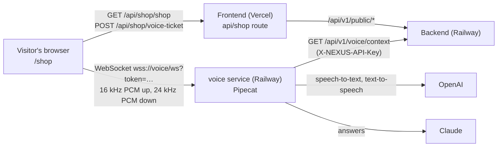

# Public shop page with a voice assistant (Pipecat)

A public page, `/shop`, shows the products managed on the **Products** page. Visitors
tap the microphone and ask in Arabic; the assistant answers out loud from the products
and the Knowledge Base.



## Pieces

| Piece | Where | What it does |
|---|---|---|
| Products page | `frontend/src/components/products/` | Add, edit, hide products with a photo, price, description |
| Products API | `backend/app/api/products.py` | `/api/v1/products` (team), `/api/v1/voice/context` (voice service), `/api/v1/public/*` (open) |
| Shop page | `frontend/src/app/shop/`, `components/shop/` | Arabic, right-to-left, no login; product grid and the voice dock |
| Microphone | `frontend/public/voice/mic-worklet.js` | Resamples the mic to 16 kHz 16-bit PCM in 40 ms chunks |
| Shop API door | `frontend/src/app/api/shop/[...path]/route.ts` | Reaches only the backend's public endpoints |
| Voice service | `voice/` | Pipecat pipeline: OpenAI speech-to-text → Claude → OpenAI text-to-speech |

## The voice pipeline

```
WebSocket in → OpenAI STT (Arabic, product names as a hint) → captions → user turn (Silero VAD)
  → Claude (products + Knowledge Base, short spoken Arabic) → captions → OpenAI TTS → WebSocket out
```

- The WebSocket format is deliberately plain (`voice/app/serializer.py`): binary frames are raw
  PCM, text frames are small JSON events (`user-text`, `bot-start`, `bot-delta`, `bot-end`,
  `interrupted`, `error`). The page needs no client library.
- While the assistant speaks, the page does not send the microphone, so it never hears itself
  through the speakers. The **Stop** button cuts it off.
- A greeting is spoken when the session opens, without calling Claude.

### Why a separate service

Pipecat's Anthropic extra requires `anthropic<2`; the backend uses `anthropic` 2.8. Keeping
Pipecat in its own container means neither breaks the other (the same reason CrewAI uses a bridge).

### Why a WebSocket and not WebRTC

Railway does not accept inbound UDP, which WebRTC needs (or a TURN server). A WebSocket runs
over ordinary HTTPS and works on Railway as it is.

## Cost brakes

| Brake | Default | Setting (voice service) |
|---|---|---|
| A session needs a signed ticket from the backend, valid 60 s, usable once | on | `VOICE_SESSION_SECRET` (same value on backend and voice) |
| Only our page may connect | the site's origin | `VOICE_ALLOWED_ORIGINS` |
| Sessions at the same time | 4 | `VOICE_MAX_CONCURRENT` |
| Length of a session | 180 s | `VOICE_MAX_SESSION_SECONDS` |
| Sessions per IP address per hour | 10 | `VOICE_MAX_SESSIONS_PER_IP_HOUR` |
| Length of an answer | 400 tokens | `VOICE_MAX_TOKENS` |

The limits live in memory, so they reset when the service restarts. That is acceptable for one
replica; several replicas would need Redis.

## Settings

**Voice service:** `OPENAI_API_KEY`, `ANTHROPIC_API_KEY`, `VOICE_AI_MODEL` (default
`claude-opus-5-5`), `VOICE_AI_EFFORT` (`low`), `OPENAI_TTS_MODEL` (`gpt-4o-mini-tts`),
`OPENAI_TTS_VOICE` (`marin`), `OPENAI_STT_MODEL` (empty: Pipecat's default), `NEXUS_API_URL`,
`NEXUS_API_KEY`, `VOICE_SESSION_SECRET`, `VOICE_ALLOWED_ORIGINS`.

**Backend:** `VOICE_SESSION_SECRET`, `VOICE_PUBLIC_WS_URL` (e.g. `wss://<voice domain>/ws`).
Without both, the shop shows products and hides the microphone.

## Deploying on Railway

1. Add a service from the GitHub repo with root directory `/voice` (it has its own Dockerfile).
2. Set its variables (above). `NEXUS_API_URL` is the backend's public HTTPS address,
   `NEXUS_API_KEY` the same key the frontend uses, `VOICE_ALLOWED_ORIGINS` the site's origin.
3. Give it a public domain.
4. On the backend set `VOICE_SESSION_SECRET` and `VOICE_PUBLIC_WS_URL=wss://<voice domain>/ws`,
   then Deploy.
5. Check `https://<voice domain>/health`: `"ready": true`.

## Verified so far

- Backend: 15 product tests (CRUD, image checks, public visibility, tickets).
- Voice service: 26 tests (tickets, limits, serializer, prompt, WebSocket refusals) with no network.
- In the browser: the shop page, the Products page, and the microphone-denied message.

Not yet verified: a spoken conversation end to end, which needs the OpenAI key and a browser
that allows the microphone.
